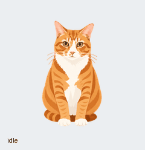

# 亚瑟桌面宠物

独立、离线的 Electron 应用，复用原有 1536×2288 透明图集，不需要 Codex。



## 下载与使用

从 [Releases](https://github.com/kevinlove0712/arthur-desktop/releases) 下载对应版本，完整解压后运行。最终用户不需要 Node.js、Codex、账号或 API Key。

- **macOS Apple 芯片**：运行 `Arthur.app`，也可拖入“应用程序”。
- **macOS Intel**：运行 Intel 版 `Arthur.app`。
- **Windows x64**：完整保留解压文件夹，运行 `Arthur.exe`。

按住拖动移动；单击跳跃；双击挥爪；鼠标靠近时目光跟随。右键宠物或点击菜单栏/托盘图标，可选择胖背影等动作、调整大小、找回宠物或退出。

当前为测试发行版：Mac Apple 芯片原生、Mac Intel 经 Rosetta 已测试；Windows 尚未真机运行验证。未完成开发者签名与 Apple 公证，首次打开可能出现系统提示。

## 开发

需要 Node.js 22.12 或更高版本。首次安装需要网络。

```sh
npm ci
npm start
npm test
npm run test:app
```

## 分平台打包

在 macOS 上可构建这三个独立压缩包：

```sh
npm run package -- mac-arm64
npm run package -- mac-x64
npm run package -- windows-x64
```

默认生成到项目根目录的 `releases/`；`build/` 是中间应用目录。Mac 使用本地临时签名（ad-hoc），没有开发者签名和公证。Windows 包没有发布者签名。不要把跨平台打包成功当作已在对应系统实测。

`main.cjs` 负责透明置顶窗口、拖动、托盘和本地设置；`renderer.js` 播放已有帧并进行透明像素命中检测；`model.js` 定义帧时长和视线方向。资源全部本地加载；渲染器禁用 Node，启用沙盒和上下文隔离。

参考：[Electron 透明窗口](https://www.electronjs.org/docs/latest/tutorial/custom-window-styles)、[点击穿透](https://www.electronjs.org/docs/latest/tutorial/custom-window-interactions)、[Electron Packager](https://electron.github.io/packager/main/)。

## 许可证

项目采用 [MIT License](LICENSE)。Electron 及其他依赖保留各自的许可证。
